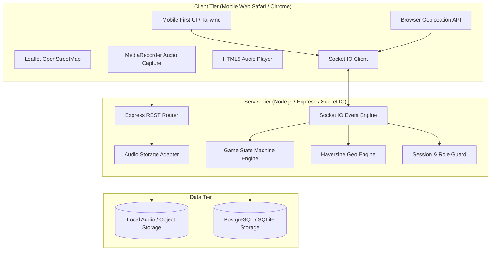

# System Architecture

## 1. Architectural Approach
We employ a **Modular Monolith** pattern:
- Cleanly decoupled frontend and backend within a single repository for simplified development, synchronization, testing, and unified type sharing.
- **Frontend**: Next.js with React 19 / 18, TypeScript, Tailwind CSS, Leaflet for OpenStreetMap rendering.
- **Backend**: Node.js HTTP + Socket.IO persistent server running TypeScript.
- **Storage**: Pluggable storage adapter (`LocalDiskStorage` for local development; `SupabaseStorage` / `S3Storage` for production).
- **Communication Protocol**:
  - HTTP REST: Room creation, radio audio upload, health checks.
  - WebSockets (Socket.IO): High-frequency real-time match events, lobby sync, proximity alerts, catch mediation.

---

## 2. Component Diagram



---

## 3. Directory Layout
```
/
├── docs/                      # Research, specs, architecture, test plan
├── client/                    # Next.js mobile-first frontend application
│   ├── src/
│   │   ├── components/        # Map, Radio, Lobby, CatchDialog, HUD
│   │   ├── hooks/             # useGeolocation, useSocket, useRadio
│   │   ├── pages/ or app/     # Pages & Routing
│   │   └── styles/            # CSS & Tailwind
├── server/                    # Node.js + Socket.IO backend service
│   ├── src/
│   │   ├── engine/            # StateMachine, Proximity, ReleaseScheduler
│   │   ├── handlers/          # Socket event handlers
│   │   ├── services/          # RoomService, MatchService, RadioService
│   │   ├── storage/           # LocalStorageAdapter, AudioStorage
│   │   └── types/             # Shared TypeScript schemas & contracts
├── package.json               # Monorepo root workspace configuration
└── README.md
```
