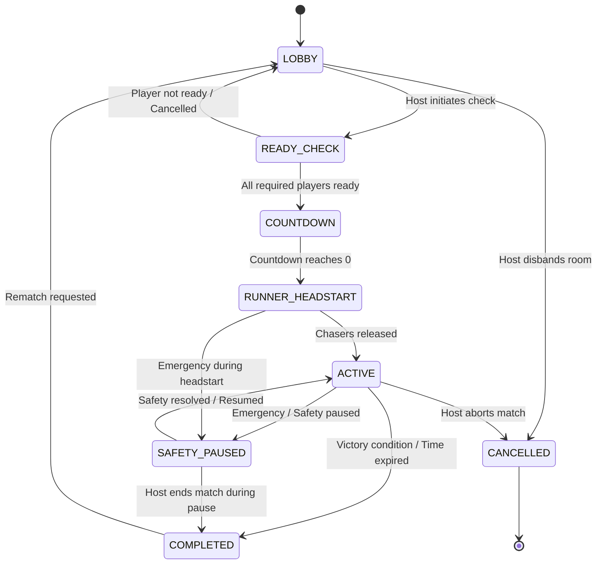

# Game State Machine

The Manhunt Web game lifecycle is strictly server-authoritative. Clients render visual representations of state transitions dictated by the backend event bus.

---

## State Diagram

---

## State Transition Specifications

### 1. `LOBBY`
- **Description**: Players join using room code. Host sets configurations, assigns teams, and selects boundary circle.
- **Allowed Transitions**:
  - `-> READY_CHECK`: Triggered by Host.
  - `-> CANCELLED`: Triggered by Host.
- **Preconditions**: Minimum 2 players (at least 1 runner, 1 chaser). Valid zone set.

### 2. `READY_CHECK`
- **Description**: All players confirm readiness and GPS permission status.
- **Allowed Transitions**:
  - `-> COUNTDOWN`: Triggered when all players are marked `READY` and GPS status is valid.
  - `-> LOBBY`: Host cancels or timeout expires.

### 3. `COUNTDOWN`
- **Description**: 5-second synchronized start countdown to prepare players physically.
- **Allowed Transitions**:
  - `-> RUNNER_HEADSTART`: Automated server timer expiration.
  - `-> SAFETY_PAUSED`: Host emergency freeze.

### 4. `RUNNER_HEADSTART`
- **Description**: Runners are released immediately (or per individual stagger). Chasers remain locked at the starting location with visible release countdowns.
- **Allowed Transitions**:
  - `-> ACTIVE`: Automated server timer when the final chaser release timestamp arrives.
  - `-> SAFETY_PAUSED`: Host/Referee emergency pause.

### 5. `ACTIVE`
- **Description**: Match is in full pursuit. Periodic location pings sent to chasers. Catch attempts enabled. Team radio active.
- **Allowed Transitions**:
  - `-> SAFETY_PAUSED`: Host/Referee triggers safety pause.
  - `-> COMPLETED`: All runners caught, or match timer expires.
  - `-> CANCELLED`: Host terminates match prematurely.

### 6. `SAFETY_PAUSED`
- **Description**: Emergency pause. Match clocks freeze. Catch attempts are disabled. Alert banner displayed on all screens with regroup coordinates.
- **Allowed Transitions**:
  - `-> ACTIVE`: Host resumes game. Server recalculates remaining durations without resetting original schedule.
  - `-> COMPLETED`: Host ends game from paused state.

### 7. `COMPLETED`
- **Description**: Match conclusion. Displays final scores, catch timestamps, and victory announcement (Runners Win or Chasers Win).
- **Allowed Transitions**:
  - `-> LOBBY`: Host triggers rematch. Resets player states while retaining room members and settings.

### 8. `CANCELLED`
- **Description**: Room is disbanded or terminated. Associated ephemeral data is purged.
