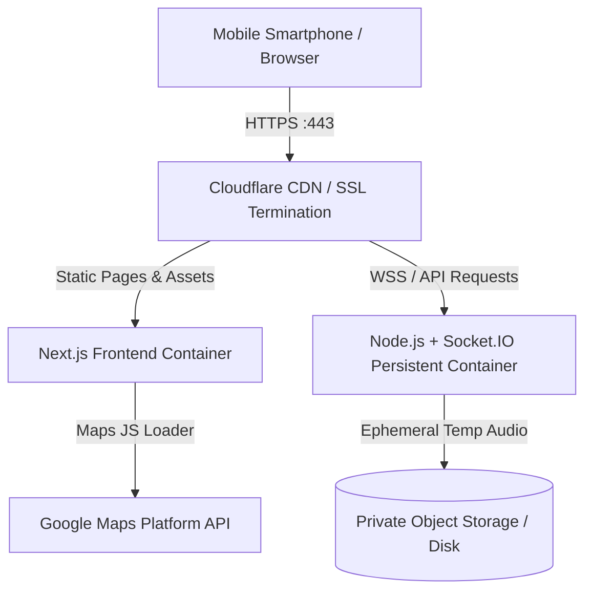

# Production Readiness Checklist & Deployment Guide

This document defines the production standards, security safeguards, Google Maps configuration, and deployment procedures for Manhunt Web.

---

## 1. Google Maps Platform Setup & Security

### 1.1 API Key Creation & Quotas
1. Navigate to the [Google Cloud Console](https://console.cloud.google.com/).
2. Create or select a project (e.g., `manhunt-game-prod`).
3. Enable billing on the project.
4. Navigate to **APIs & Services > Library** and enable **Maps JavaScript API**.
5. Navigate to **APIs & Services > Credentials** and click **Create Credentials > API Key**.

### 1.2 HTTP Referrer Restrictions (Mandatory for Web Security)
Under **Application Restrictions**, choose **Websites**:
- Development:
  - `http://localhost:3000/*`
  - `http://127.0.0.1:3000/*`
  - `http://192.168.*:*/*` (for local LAN mobile testing)
- Production:
  - `https://your-manhunt-domain.com/*`

### 1.3 API Scope Restriction
Under **API Restrictions**, select **Restrict key**:
- Select exclusively: **Maps JavaScript API**.
- Do NOT enable Directions, Places, or Geocoding APIs unless specifically used, avoiding unexpected billing vectors.

### 1.4 Setting the Environment Variable
In `client/.env.local` or production environment variables:
```bash
NEXT_PUBLIC_GOOGLE_MAPS_API_KEY=AIzaSy...your-restricted-key
```

---

## 2. Security & Hardening Controls

### 2.1 Server-Side Authorization
- **Role Isolation**: Only actors with role `HOST` can start, configure, resume, or abort matches.
- **Safety Pause Privilege**: Only `HOST` and `REFEREE` can trigger an emergency safety freeze.
- **Catch Code Protection**: Runner Catch Codes are never broadcast to opposing chasers. The code is kept in memory and validated on the backend. Failed code attempts are throttled to 3 per chaser to prevent brute forcing.
- **Ephemeral Audio Storage**: Uploaded voice clips are stored with unique GUIDs and auto-deleted within 10 minutes or immediately upon room termination.

### 2.2 Data Privacy Lifecycle
- Coordinates are never written to disk or database logs.
- Match locations are stored strictly in volatile Node.js heap memory for the active room session.
- Once a room closes or match completes, all coordinates are garbage collected.

---

## 3. Production Deployment Architecture



### Hosting Recommendations:
1. **Frontend**: Vercel, Cloudflare Pages, or Docker container on Google Cloud Run.
2. **Backend**: Requires a persistent container (e.g. Google Cloud Run with WebSockets, Fly.io, or Railway). Avoid serverless AWS Lambda for the backend as Socket.IO requires persistent TCP/WebSocket connections.
3. **SSL / HTTPS**: Mandatory. Modern mobile browsers block `navigator.geolocation` and `navigator.mediaDevices.getUserMedia` over insecure HTTP connections.
