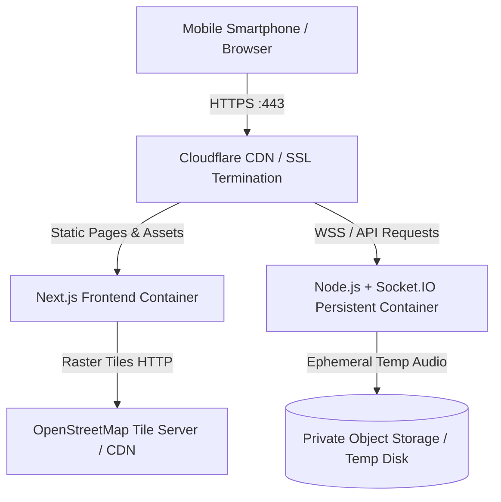

# Production Readiness Checklist & Deployment Guide

This document defines the production standards, security safeguards, OpenStreetMap and Leaflet configuration, and deployment procedures for Manhunt Web.

---

## 1. OpenStreetMap & Tile Provider Architecture

### 1.1 Development & Light Testing
The application uses Leaflet with OpenStreetMap raster tiles directly:
```
https://tile.openstreetmap.org/{z}/{x}/{y}.png
```
- **Attribution**: Displayed visibly on the map:
  `© OpenStreetMap contributors` with links to `https://www.openstreetmap.org/copyright`.
- **Zero API Keys Required**: No Google Cloud account, API keys, or billing configuration are needed.
- **Client-Side Rendering**: Loaded dynamically via `next/dynamic` with `ssr: false` to ensure seamless compatibility with Next.js 15 server-side rendering.

### 1.2 OpenStreetMap Tile Usage Policy Compliance
Per the [OpenStreetMap Foundation Tile Usage Policy](https://operations.osmfoundation.org/policies/tiles/):
- **No Bulk Prefetching**: Tiles are fetched on-demand by Leaflet strictly as the user navigates.
- **No Heavy Automated Scraping**: No automated tile scraping or bulk caching scripts exist in the repository.
- **Valid User-Agent / Referrer**: Browser standard HTTP headers are sent with all tile requests.
- **Production Scaling**: If application concurrent user volume scales beyond light playtesting, configure an enterprise tile provider (e.g. Mapbox, Stadia Maps, CARTO, Jawg Maps, or a self-hosted `osm-tile-server` container) via `NEXT_PUBLIC_MAP_TILE_URL`.

---

## 2. Security & Hardening Controls

### 2.1 Server-Side Authorization
- **Role Isolation**: Only actors with role `HOST` can start, configure, resume, or abort matches.
- **Safety Pause Privilege**: Only `HOST` and `REFEREE` can trigger an emergency safety freeze.
- **Catch Code Protection**: Runner Catch Codes are never broadcast to opposing chasers. The code is kept in memory and validated on the backend. Failed code attempts are throttled to 3 per chaser to prevent brute forcing (30-second lockout).
- **Ephemeral Audio Storage**: Uploaded voice clips are stored with unique GUIDs and auto-deleted within 10 minutes or immediately upon room termination.

### 2.2 Data Privacy Lifecycle
- Coordinates are never written to disk or database logs.
- Match locations are stored strictly in volatile Node.js heap memory for the active room session.
- Once a room closes or match completes, all coordinates are discarded from memory.

---

## 3. Production Deployment Architecture



### Hosting Recommendations:
1. **Frontend**: Vercel, Cloudflare Pages, or Docker container on Google Cloud Run.
2. **Backend**: Requires a persistent container (e.g. Fly.io, Railway, Render, or Google Cloud Run with WebSockets enabled). Avoid serverless AWS Lambda for the backend as Socket.IO requires persistent TCP/WebSocket connections.
3. **SSL / HTTPS**: Mandatory in production. Modern mobile browsers block `navigator.geolocation` and `navigator.mediaDevices.getUserMedia` over insecure HTTP connections outside of `localhost`.
